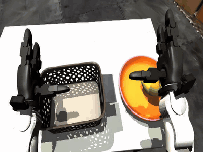
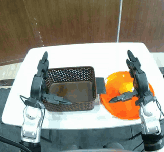
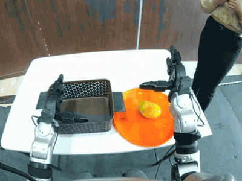
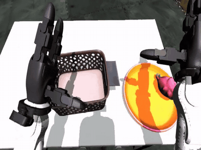
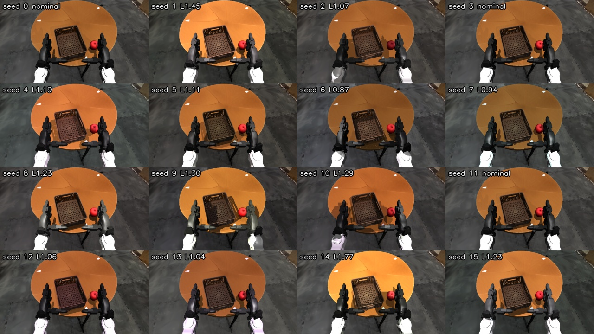
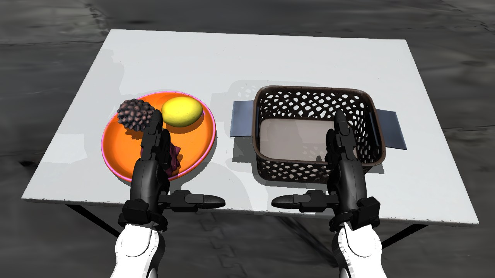

<div align="center">

# Real2Sim2Real

### Photoreal digital twins from a phone video, for training humanoid VLA policies without real-world data

<!-- Authors and affiliations go here, e.g.
[Name](link)<sup>1</sup>, [Name](link)<sup>1</sup>  ·  <sup>1</sup>Affiliation -->

[](https://github.com/aasthaverma27/real2sim2real)
[](https://huggingface.co/aasthaverma27/pi05-g1-fruit-v2)
[](LICENSE)

<table>
<tr>
<td align="center"></td>
<td align="center"></td>
</tr>
<tr>
<td align="center"><sub><b>Simulation</b>: a teleoperated training episode in the reconstructed room</sub></td>
<td align="center"><sub><b>Real robot</b>: the π0.5 policy trained only on simulated episodes</sub></td>
</tr>
</table>

</div>

Real2Sim2Real turns a phone video of a room into a metric, photoreal MuJoCo
scene. A Unitree G1 humanoid is teleoperated in it through its deployed
whole-body controller, and the recorded episodes are used to fine-tune a
vision-language-action policy. The policy then runs on the real robot.

The simulator is built to close the two gaps a visuomotor policy can see.
- **Visual gap.** The room is a 3D Gaussian splat of the real room. The robot
  and the objects are MuJoCo meshes composited into it. The robot's three
  cameras use measured intrinsics and CAD-derived mounts.
- **Control gap.** The scene is in metres and the objects have collision hulls
  and physical properties. The robot is driven by the same whole-body
  controller (NVIDIA GR00T-WBC), over the same DDS interface, as the real G1.

## News

- **2026-10**: Released the `new_table_env` fruit scene, the π0.5 fine-tuning
  and deployment code, and the
  [`pi05-g1-fruit-v2`](https://huggingface.co/aasthaverma27/pi05-g1-fruit-v2)
  checkpoint.

## Contents

- [Overview](#overview)
- [Results](#results)
- [Installation](#installation)
- [Prebuilt scenes](#prebuilt-scenes)
- [Building a scene from your own room](#building-a-scene-from-your-own-room)
- [Collecting demonstrations](#collecting-demonstrations)
- [Training π0.5](#training-π05)
- [Deployment](#deployment)
- [Method details](#method-details)
- [Repository structure](#repository-structure)
- [Acknowledgements](#acknowledgements)
- [Citation](#citation)

## Overview

```
 phone video ─► COLMAP ─► 3DGS (objects painted out) ─► auto-align (floor, lens, scale)
                                                              │
 one photo ─► SAM 3 masks ─► SAM-3D meshes ─► collision + physics ─► metric MuJoCo scene
                                                              │
               G1 + calibrated camera rig ─────────────► scene_g1.xml (render) / scene_wbc.xml (sim)
                                                              │
   Pico VR ─► teleop ─► GR00T-WBC ◄── DDS 99 ──► MuJoCo sim ──┼─► hybrid render (3 robot cameras)
                                                              └─► LeRobot exporter ─► dataset
                                                                                         │
                       real G1 ◄── GR00T-WBC ◄── π0.5 policy ◄── openpi fine-tuning ◄────┘
```

| Stage | What happens |
|---|---|
| **Reconstruct** | Background splat from a phone video. Object meshes from one photo. Everything aligned to gravity and metric scale automatically. |
| **Simulate** | MuJoCo physics, Gaussian-splat background, the deployed whole-body controller in the loop |
| **Collect** | Pico VR teleoperation, object layout and lighting randomized every episode, exported as LeRobot v2.1 |
| **Train** | Full fine-tune of π0.5 on the 28 upper-body joints. Arms trained as deltas, hands as absolute positions. |
| **Deploy** | One policy loop for the real G1 and the simulator. Same cameras, state and controller. |

## Results

**Pick and place on the real G1.** The policy is
[`pi05-g1-fruit-v2`](https://huggingface.co/aasthaverma27/pi05-g1-fruit-v2) at
step 10,000. It was trained on 412 simulated episodes and no real-robot data.
The prompt is *"pick up the mango and place it in the basket"*. The clips are
from the head camera and play at 3–4× speed. They are two example rollouts, not
a measured success rate; a systematic real-robot evaluation is in progress.

<table>
<tr>
<td align="center"></td>
<td align="center"></td>
</tr>
</table>

**Training data.** The demonstrations were recorded in `scenes/new_table_env`,
the reconstructed counterpart of the real setup.

<table>
<tr>
<td align="center"><br><sub>"pick up the mango and place it in the basket"</sub></td>
<td align="center"><br><sub>"pick up the dragon-fruit and place it in the basket"</sub></td>
</tr>
</table>

### Released checkpoint

| Model | Base | Training data | Steps | Download |
|---|---|---|---|---|
| `pi05_g1_fruit_v2` | `pi05_base`, full fine-tune | 412 sim episodes (mango, dragon fruit), 123,821 frames at 20 Hz; 10 episodes held out | 30,000 at batch 32; checkpoints every 1,000 | [🤗 Hugging Face](https://huggingface.co/aasthaverma27/pi05-g1-fruit-v2) |

Each step directory holds `params/` and `assets/` (normalisation statistics), so
any step can be served directly. See [Deployment](#deployment).

## Installation

Requirements:
- Ubuntu 22.04 or later
- an NVIDIA GPU with at least 16 GB of memory (24 GB recommended), and a driver for CUDA 12.8
- conda, git, git-lfs and ffmpeg

Teleoperation also needs docker and a Pico 4 or 4 Ultra headset. Fine-tuning
π0.5 needs about 70 GB of GPU memory.

```bash
sudo apt install git-lfs && git lfs install
git clone https://github.com/aasthaverma27/real2sim2real.git
cd real2sim2real
git lfs pull                                         # prebuilt scenes

bash scripts/install_auto_pipeline.sh -y --only sim  # simulation environment + configs/paths.env
bash scripts/doctor.sh                               # checks the setup
```

To build scenes from your own captures, install the reconstruction models as
well. SAM 3 and SAM-3D-Objects are gated on Hugging Face, so accept their terms
first.

```bash
huggingface-cli login
bash scripts/install_auto_pipeline.sh -y --download-checkpoints
bash scripts/fetch_g1_meshes.sh                      # stock Unitree G1 meshes
```

For teleoperation, recording and deployment, set up the whole-body-controller
stack. This is NVIDIA's
[GR00T-WholeBodyControl](https://github.com/NVlabs/GR00T-WholeBodyControl),
pinned as a submodule, with one patch.

```bash
bash scripts/setup_external.sh
cd external/GR00T-WholeBodyControl && ./decoupled_wbc/docker/run_docker.sh --install --root
```

The environments pin conflicting CUDA and torch builds, so they are kept
separate. [docs/automatic_pipeline_setup.md](docs/automatic_pipeline_setup.md)
lists them, and [docs/external_dependencies.md](docs/external_dependencies.md)
describes the patch.

## Prebuilt scenes

Both scenes are the same reconstructed room with the same G1 and camera rig.
They differ in what is on the table. Each passes every check in
`scripts/realsim/verify_scene.py`.

<table>
<tr>
<td width="50%" align="center"><br><b><code>scenes/new_env</code></b></td>
<td width="50%" align="center"><br><b><code>scenes/new_table_env</code></b></td>
</tr>
<tr>
<td valign="top">

Round wooden table, a red apple and a woven basket. On every reset the apple
and basket move anywhere in the robot's reachable half of the table.

```bash
scripts/realsim/start.sh --scene scenes/new_env --builtin
```

</td>
<td valign="top">

White table (0.91 × 0.56 m), an orange plate with fruit and a brown basket,
built from 18 phone photos and tape-measured sizes. On every reset the plate
and basket move by up to ±4 cm around their photographed spots, the basket
turns by up to ±15°, and the fruit is shuffled on the plate.

```bash
scripts/realsim/start.sh --scene scenes/new_table_env --builtin \
    --mango --dragon-fruit
```

</td>
</tr>
</table>

`start.sh` opens the MuJoCo sim, the photoreal hybrid view and the robot's head
camera. `--builtin` runs a balance controller in-process. Without it, the sim
waits on DDS domain 99 for the deployed controller, as the real robot does on
domain 0, and prints the container command. Backspace in the sim window starts
a new episode. `--stop` closes everything.

| Flag | Effect |
|---|---|
| `--builtin` | in-process balance controller instead of the deployed WBC |
| `--vla` | serve the three robot cameras on `:5555` for the recorder or a policy |
| `--visual-dr [CONFIG]` | new lighting, colours and background on every reset |
| `--fixed-layout`, `--layout-seed N` | no reshuffle on reset / reproducible reshuffles |
| `--mango`, `--dragon-fruit`, `--grapes`, `--apple`, `--kiwi`, `--blue-octopus`, `--pink-octopus`, `--unicorn` | `new_table_env`: objects to put on the plate. The plate is empty by default. Use three or four at most. |
| `--paused`, `--hold` | inspect a scene without a controller |

In `new_table_env` the robot rests with its elbows bent by 0.5 rad, so the
hands clear the basket rim. The sim spawns in that pose. `start.sh` prints the
controller command with `G1_DEFAULT_ELBOW=-0.5` so the WBC holds the same pose.

## Building a scene from your own room

1. **Capture.**
   - Take the objects off the table.
   - Film the room in one continuous 40–60 s take, at several heights, with
     exposure locked.
   - Put the objects back and take one photo.
   - Measure the table height.

   [docs/scene_pipeline.md](docs/scene_pipeline.md#0-capture) explains why each
   of these rules matters.
2. **Build.** One command runs every stage and resumes where it stopped:

   ```bash
   bash scripts/build_sim_scene.sh \
       --scene-dir outputs/myroom \
       --room-video room_no_objects.mp4 \
       --object-image objects_on_table.jpg --object-free-video \
       --objects "the round wooden table,the red apple,the woven brown basket" \
       --table-body obj0_round_wooden_table --table-height 0.75 \
       --check-body obj2_woven_brown_basket --check-size 0.245 0.19 \
       --robot-at 0.0 0.42 --robot-yaw 1.54
   ```

   The stages:
   - COLMAP
   - 3DGS
   - gravity, lens and scale alignment
   - SAM 3 masks and SAM-3D meshes
   - collision and physical properties
   - re-seating the objects on the splat
   - robot attachment
   - the controller scene
   - verification

   [docs/scene_pipeline.md](docs/scene_pipeline.md) covers every stage and flag.
3. **Calibrate the cameras** (other robots only). Our G1's measured values are
   already in `assets/robots/g1/` and `calib/`. Fields of view: head 53.35°,
   wrists 63.34°. See [docs/camera_calibration.md](docs/camera_calibration.md).

## Collecting demonstrations

```bash
scripts/realsim/start.sh --scene scenes/new_table_env --vla --visual-dr --mango --dragon-fruit
#   in the WBC container: controller (press ]), Pico teleop, LeRobot exporter (keys c / x)
scripts/realsim/finalize_dataset.sh fruit-pnp <session> [<session> ...]
```

Each episode records:
- the head camera and both wrist cameras (480 × 640)
- the 43-D joint state and action
- the wrist poses

at 20 Hz. The visual look comes from one broadcast seed, so every camera agrees
and any episode can be re-rendered. The sim also logs the layout drawn at every
reset to `<scene>/episode_layouts/`.
[docs/teleop_dataset.md](docs/teleop_dataset.md) covers the container commands,
Pico setup, recording keys and randomization ranges.

## Training π0.5

Fine-tuning uses a fork of [openpi](https://github.com/Physical-Intelligence/openpi),
checked out at `external/openpi`. The fork adds:
- the G1 + Dex3 policy transforms
- the `pi05_g1_*` train configs
- validation loss
- checkpoint tests

```bash
git submodule update --init external/openpi
cd external/openpi && GIT_LFS_SKIP_SMUDGE=1 uv sync && GIT_LFS_SKIP_SMUDGE=1 uv pip install -e .

export HF_LEROBOT_HOME=$HOME/lerobot_datasets
python ../../scripts/pi05/split_dataset.py <dataset> --out $HF_LEROBOT_HOME/fruit-pnp --val-per-task 5
uv run scripts/compute_norm_stats_g1_dex3.py --config-name pi05_g1_my_task
XLA_PYTHON_CLIENT_MEM_FRACTION=0.9 uv run scripts/train.py pi05_g1_my_task --exp-name run1
```

[docs/finetune_pi05.md](docs/finetune_pi05.md) covers adding a train config,
checkpoint tests, offline evaluation and the settings that matter.

## Deployment

The policy server runs on a GPU machine. The policy loop runs in the
whole-body-controller container and sends the policy's 28 upper-body targets to
the WBC. The same loop drives the real robot and the simulator.

```bash
# policy server (released checkpoint, step 10000)
huggingface-cli download aasthaverma27/pi05-g1-fruit-v2 --include "10000/*" --local-dir checkpoints/pi05_g1_fruit_v2
uv run --project external/openpi python scripts/pi05/serve_pi05.py --checkpoint-dir checkpoints/pi05_g1_fruit_v2/10000

# policy loop, inside the WBC container with the controller running
docker exec -it -w /root/Projects/GR00T-WholeBodyControl -e ROS_LOCALHOST_ONLY=1 decoupled_wbc-bash-root bash
source /root/venv/bin/activate; source /opt/ros/humble/setup.bash
export PYTHONPATH=/root/Projects/GR00T-WholeBodyControl:$PYTHONPATH
python decoupled_wbc/control/main/pi05/run_pi05_policy.py --probe --policy-host <gpu-host>
python decoupled_wbc/control/main/pi05/run_pi05_policy.py --policy-host <gpu-host> \
    --frequency 25 --execute-steps 25 \
    --prompt "pick up the mango and place it in the basket"
```

Most real-robot runs used these settings: 25 Hz, 25-step chunks, arm deltas
and absolute hand targets (the last three are the defaults).
Every container process (controller, teleop, exporter, policy loop) needs
`ROS_LOCALHOST_ONLY=1`, or the nodes do not see each other. Prefix `docker`
with `sudo` if your user is not in the docker group.
In simulation, start the scene with `--vla`. On the real robot, add
`--camera-host <robot-ip>`. Every rollout is saved to `inference_recordings/`
with the head-camera video and each action chunk.

## Method details

**One splat, one take.** The background is a single 3DGS reconstruction of one
continuous capture. Two captures stitched together leave a blurred seam where
they meet. A feed-forward reconstruction averages views that disagree instead
of reconciling them.

**Alignment without fitting.** The object photo is registered in the same
COLMAP model as the video, so its camera is shared by both reconstructions. The
rest is read off the splat:
- gravity, from a RANSAC floor plane
- the lens, from bundle adjustment
- scale, from the floor-to-tabletop distance against the measured table height

Objects are then re-seated on the splat by ray-casting their masks.

**Two scenes per room.** The renderer needs the robot attached into the room.
The controller needs the robot's own joint names, with its floating base at
joint 0. `build_wbc_scene.py` merges the other way round, and
`scene_wbc.frame.json` records the shift that every renderer undoes.

**Camera parity.** The sim renders at each stream's published resolution, with
the measured field of view, and then applies the real client's resize to
640 × 480.

[docs/real2sim_experiments.md](docs/real2sim_experiments.md) lists what was
measured and what failed along the way.

## Repository structure

```
scenes/                 prebuilt scenes (Git LFS): new_env, new_table_env
scripts/
  build_sim_scene.sh    one-command scene build
  realsim/              simulation stack: start.sh, controller scene, camera server,
                        randomizers, calibration tools, dataset finalizer
  pi05/                 policy server and dataset split for π0.5
  doctor.sh             environment check
configs/                robot descriptors, randomization ranges, machine paths
assets/robots/g1/       G1 models and camera-rig CAD
calib/                  measured camera intrinsics
robosnap/               object reconstruction package
external/               GR00T-WholeBodyControl (controller, teleop, exporter), openpi fork
patches/                our changes to third-party code
docs/                   detailed guides
```

[docs/troubleshooting.md](docs/troubleshooting.md) covers common errors.

## Acknowledgements

This work builds on:
- [RoboSnap](https://robosnap.github.io) for object reconstruction
- [MuGS](https://github.com/Renforce-Dynamics/MuGS) for the MuJoCo Gaussian-splat sensor
- [Re3Sim](https://xshenhan.github.io/Re3Sim/) for the compositing rule
- [openpi](https://github.com/Physical-Intelligence/openpi) for π0.5
- [NVIDIA GR00T-WholeBodyControl](https://github.com/NVlabs/GR00T-WholeBodyControl) for the whole-body controller, teleoperation and exporter

It also uses SAM 3, SAM-3D-Objects, VGGT, COLMAP and gsplat for segmentation,
meshes, depth, camera poses and splat training, and Unitree's G1 model and SDK.

## License

The first-party code is released under the Apache 2.0 license (see
[LICENSE](LICENSE) and [NOTICE](NOTICE)). Third-party components, submodules
and model weights keep their own licenses.

## Citation

```bibtex
@misc{real2sim2real2026,
  title        = {Real2Sim2Real: Photoreal Digital Twins from a Phone Video for Training Humanoid VLA Policies},
  author       = {Aastha Verma},
  year         = {2026},
  howpublished = {\url{https://github.com/aasthaverma27/real2sim2real}}
}
```
