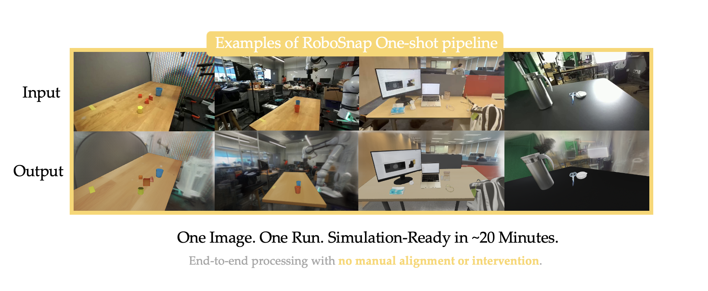

# real2sim2real

Turn photographs of a real room into a MuJoCo simulation that a real robot
controller can drive, rendered against a photoreal Gaussian splat of the room
the photos came from.

From one image (plus a phone video for the background) you get object meshes
with collision hulls and physical properties, a MuJoCo scene at **true metric
scale**, a Gaussian splat aligned to it, any robot placed in it driven by **its
own whole-body controller**, a hybrid render where robot and objects are
simulated and everything behind them is the real room, and the robot's own
cameras — including fisheye stereo — streamed over ZMQ.

<p align="center"></p>

```
1  Install                     2  Build a scene from your photos
3  Run it                      4  Add the photoreal background
5  Use your own robot          6  Drive it with a real controller
7  How it works                8  Troubleshooting
```

---

## 1. Install

```bash
git clone --recursive https://github.com/MethdAI-Modinoid/real2sim2real.git
cd real2sim2real

bash scripts/install_auto_pipeline.sh     # environments + configs/paths.env
```

That is the whole install. The installer creates the conda environments,
downloads what it needs, and **writes `configs/paths.env` for you** with the
interpreters it just built — there is nothing to edit and nothing to `source`.
Every script loads it by itself.

renderer, free VRAM against your ceiling, the display, and which optional
extras are present — printing the fix beside anything that fails. Everything
below assumes it ends with `ready`.

<details>
<summary>Four environments, and why they cannot be one</summary>

| env | holds | used by |
|---|---|---|
| `robosnap-sim` | mujoco, gsplat, MuGS, cv2, zmq, onnxruntime | simulation, rendering, controllers |
| `robosnap-lyra` | pycolmap, gsplat, torch cu128 | COLMAP, splat training and evaluation |
| `robosnap-asset` | SAM-3D, VGGT, trimesh | object reconstruction |
| `robosnap-sam3` | SAM 3 | segmentation |

They pin conflicting CUDA and torch builds, which is why they are separate
rather than one large env. Install a subset with
`bash scripts/install_auto_pipeline.sh --only sim`, or exclude one with
`--skip-lyra`.

`configs/paths.env` names each one as `$RS_PY_SIM`, `$RS_PY_LYRA`,
`$RS_PY_ASSET`, `$RS_PY_SAM3`, so commands below say which they need. Source it
once per shell:

```bash
source configs/paths.env
```

That also puts the simulation env's `bin` on `PATH`, which gsplat's CUDA JIT
needs — without it the first render fails with `Ninja is required to load C++
extensions`.
</details>

<details>
<summary>A robot model (none are committed here)</summary>

Robot models belong to their manufacturers and are gitignored, so fetch one:

```bash
bash scripts/fetch_robot.sh --list                  # MuJoCo Menagerie catalogue
bash scripts/fetch_robot.sh unitree_h1              # or any Menagerie model
bash scripts/fetch_robot.sh --from /path/robot.xml --name my_robot
```

Nothing in the codebase is robot-specific. See
[assets/robots/README.md](assets/robots/README.md) for what a model must satisfy
to be drivable by a whole-body controller.
</details>

<details>
<summary>External stacks — only for a deployed controller or a VLA policy</summary>

```bash
bash scripts/setup_external.sh --check              # what is reachable
bash scripts/setup_external.sh                      # fetch it
```

| submodule | licence | public | needed for |
|---|---|---|---|
| `external/Isaac-GR00T` | Apache-2.0 | yes | VLA policy server |
| `external/unitree_sdk2_python` | permissive | yes | DDS bridge |
| `external/simple_wbc_code` | none stated | third-party | balance/walk ONNX, teleop |
| `external/vla_for_simulation_testing` | mixed | **no** | DDS sim bridge, WBC container, client |

Submodules, never vendored: the controller is under the NVIDIA License, which
limits use to non-commercial research and attaches conditions to
redistribution. A submodule keeps those terms with its licensor.

**None of these are needed** for §2–§5. Reasoning and the licence detail:
[docs/external_dependencies.md](docs/external_dependencies.md).
</details>

---

## 2. Build a scene from your photos

### What to shoot

One photograph is enough for the objects. The photoreal background wants a
**video**: walk a slow circle around the working area, keep the table and floor
in frame, avoid motion blur. ~400 frames at 1080p is plenty.

Two things cannot be fixed later:

* **Measure one object.** Reconstruction is scale-free — it recovers correct
  proportions and an arbitrary absolute size. One real dimension sets the true
  size of everything else, so measure it with a tape.
* **Shoot the frame you want reconstructed first.** Object-to-background
  alignment assumes the video's *first* frame is the object image, so trim so
  that is true.

If your phone writes `rotation=-90` metadata, bake it into the pixels — the
readers ignore metadata and would rebuild the room on its side:

```bash
mkdir -p inputs
ffmpeg -i raw.mp4 -an -c:v libx264 -crf 16 inputs/room.mp4
ffmpeg -ss 17.5 -i inputs/room.mp4 -an -c:v libx264 -crf 16 inputs/scene.mp4
ffmpeg -i inputs/scene.mp4 -vframes 1 inputs/frame0.png
```

### Objects, scale and the robot — one command

**~20 minutes, ~17 GB VRAM.**

```bash
bash scripts/fetch_robot.sh unitree_g1         # any robot; none ship with the repo

bash scripts/build_scene.sh \
    --image   inputs/frame0.png \
    --out     outputs/kitchen \
    --objects "the round wooden table,the red apple,the woven brown basket" \
    --measure obj0_round_wooden_table=0.745 \
    --check   obj2_woven_brown_basket=0.245,0.19 \
    --robot   unitree_g1 --at 0.0 1.2 --yaw -1.57
```

That runs every stage — segmentation, meshes, collision hulls, physical
properties, MJCF export, metric rescale, robot placement — and prints the scene
path when it finishes. Completed stages are skipped on re-run, so an
interrupted build resumes instead of starting over.

Name objects the way you would point at them; body names come out as
`obj0_<slug>`, `obj1_<slug>`, in the order you list them.

> **`--measure BODY=METRES` is the number you cannot guess** (see above).
> `--check BODY=W,H` is a second measurement used only as a cross-check — if
> its prediction is far off, the mask or the mesh is wrong.

Mask quality dominates everything downstream. If a stage fails or an object
looks wrong, inspect `outputs/kitchen/masks/`, fix them in the GUI
(`bash scripts/run_gui.sh`), and re-run.

If height and diameter cannot both come out right, one global factor is not
enough and the mesh scale has to go non-uniform — worked case in
[docs/example_scene_g1_apple.md](docs/example_scene_g1_apple.md).

Prefer the individual stages? They are in
[docs/pipeline_commands.md](docs/pipeline_commands.md).

---

## 3. Run it

```bash
bash scripts/realsim/start.sh --scene outputs/kitchen
```

Three windows — the MuJoCo sim, the photoreal hybrid, and the robot's cameras —
all showing **one** simulation.

```
--builtin      run the bundled ONNX controller in-process (needs only the weights)
--hold         hold the initial pose instead of falling
--stop         close everything   (or: bash scripts/realsim/start.sh --stop)
--scene DIR --robot NAME
```

By default the sim prints `WAITING FOR WBC` and the robot falls under gravity
until a controller publishes — the same behaviour as the reference stack. Start
yours whenever; it is picked up mid-run. Restart the stack just before you do,
though: **no controller can stand up from prone.**

The script refuses to launch if it would cross the VRAM ceiling in
`configs/paths.env`, waits for each stage's readiness line rather than guessing,
and prints the log tail if a stage fails. Logs land in `/tmp/realsim/`.

Look at just the scene, without the splat:

```bash
MUJOCO_GL=glfw $RS_PY_SIM -m mujoco.viewer \
    --mjcf=outputs/kitchen/mujoco/scene_robot.xml
```

---

## 4. Add the photoreal background

Until this runs, the hybrid render shows a plain MuJoCo floor rather than your
room.

Feed-forward reconstruction from one clip leaves holes exactly where the robot
looks, so train on the full COLMAP reconstruction instead — the single
highest-value step here. Measured effect on the robot's own view: **81.5% black
→ 15.8%.**

```bash
$RS_PY_LYRA scripts/colmap_from_video.py --video inputs/scene.mp4 \
    --out outputs/kitchen/roommesh --long-side 1200

$RS_PY_LYRA scripts/train_gs.py \
    --colmap    outputs/kitchen/roommesh/dense \
    --image-dir outputs/kitchen/roommesh/dense/images \
    --out       outputs/kitchen/gs_wide.ply \
    --iters 30000 --long-side 1200 --holdout 12 --vram-limit-gb 26
```

~13 min, 6.7 GB VRAM, ~3.6M gaussians. Expect PSNR ≈ 27 dB, SSIM ≈ 0.92.

### Align it to the scene

Each part of the transform comes from a different constraint, because no single
one determines all of it: **gravity** from the camera-orbit plane's normal,
**scale** from your measurement cross-checked against the depth buffer,
**position** from the tabletop plane, **yaw** from your eyes.

```bash
# scale, from depth - image appearance cannot determine it
$RS_PY_SIM scripts/fit_splat_depth.py --ply outputs/kitchen/gs_wide.ply \
    --scene outputs/kitchen/mujoco/scene_scaled.xml

# yaw, by eye against the photograph
$RS_PY_SIM scripts/tune_splat_yaw.py --ply outputs/kitchen/gs_wide.ply --scale 0.3965

# bake it, then clear the volume your meshes now occupy
$RS_PY_SIM scripts/apply_splat_transform.py --ply outputs/kitchen/gs_wide.ply \
    --out outputs/kitchen/gs_bg.ply --scale 0.3965 --yaw 268.0 --min-opacity 0.02

$RS_PY_SIM scripts/prune_splat.py --ply outputs/kitchen/gs_bg.ply \
    --mjcf outputs/kitchen/mujoco/scene_scaled.xml \
    --out  outputs/kitchen/gs_bg_clean.ply --keep-below 0.03
```

> **Scale is not recoverable from one image.** Scaling a scene about the camera
> centre leaves every pixel where it was — the projection cancels it exactly.
> Depth does not cancel, which is what `fit_splat_depth.py` exploits.
>
> **Do not trust an automated yaw fit.** Five objectives gave five different
> answers on the example scene; each locks onto a feature that repeats or
> mirrors elsewhere in the room. Set it by eye.

Then `bash scripts/realsim/start.sh --scene outputs/kitchen` again, and the background is
your real room.

---

## 5. Use your own robot

One YAML descriptor per robot. **No code changes** — the pipeline has no idea
which robot it is driving. The shipped G1 descriptor is a worked example, not a
dependency.

```bash
bash scripts/fetch_robot.sh unitree_h1
cp configs/robots/g1_29dof_with_hand.yaml configs/robots/my_robot.yaml
$EDITOR configs/robots/my_robot.yaml
```

```yaml
name: my_robot
mjcf: assets/robots/my_robot/my_robot.xml

sim:                          # what a deployed controller requires
  base_joint: floating_base_joint
  root_body: pelvis
  n_robot_joints: 43

body_joints: [ ... ]          # the order the controller's observation uses
hand_finger_order: [ ... ]    # per-hand order, if it has hands
hand_sides: [left, right]

wbc:
  balance_onnx: ${RS_WBC_MODELS}/Balance.onnx
  walk_onnx:    ${RS_WBC_MODELS}/Walk.onnx
  n_act: 15                   # joints the nets emit
  kp: [ ... ]                 # one per body joint
  kd: [ ... ]
  default_pose: [ ... ]

cameras:
  mount_body: head_link
  pos: [0.075, 0.0, 0.385]
  pitch_deg: 20
  stereo: {projection: equidistant_fisheye, baseline_m: 0.06, fov_deg: 170}
```

Then pass `--robot my_robot` everywhere. Array lengths are validated against
each other and against the compiled model.

> **`body_joints` order is not cosmetic.** The observation is indexed by
> position, so a reordered list silently sends knee commands to a shoulder.
> Hand fingers are the same trap: a policy may order them `index, middle,
> thumb` while the MJCF is thumb-first, and getting it wrong closes the wrong
> fingers on every grasp — with contacts registering, so it reads as a physics
> bug rather than an indexing one.

**What a deployed controller demands of the model:** a free joint on the root
named in `sim.base_joint`; root and torso bodies named as the controller expects
and **not** namespaced; that free joint compiling to **joint 0** with hinges at
1..N and nothing in front, because state is read as `qpos[joint_id + 6]`.
`scripts/realsim/build_wbc_scene.py` checks the last two at build time — a scene
that violates them does not error, it quietly drives the wrong joints.

### Cameras

MuJoCo cameras are strictly rectilinear pinhole, so a 180° fisheye is rendered
as a five-face cubemap and remapped to an equidistant fisheye (`r = f·θ`):

```bash
MUJOCO_GL=egl $RS_PY_SIM scripts/fisheye_render.py \
    --mjcf outputs/mine/mujoco/scene_robot.xml \
    --ply  outputs/mine/gs_bg_clean.ply \
    --eye both --fov-h 170 -o /tmp/fisheye.png
```

`start.sh` streams them live. To tilt a head that has **no neck joint** (a geom
on the torso), rewrite the camera frame — and apply it to both the built scene
and the robot MJCF, because `MjSpec.attach` inlines the robot and a built scene
never re-reads it:

```bash
$RS_PY_SIM scripts/set_head_tilt.py --xml outputs/mine/mujoco/scene_robot.xml --prefix g1_ --pitch 20
$RS_PY_SIM scripts/set_head_tilt.py --xml assets/robots/my_robot/my_robot.xml --pitch 20
```

---

## 6. Drive it with a real controller

`--builtin` runs the ONNX nets in-process and is the quickest way to see the
scene work. For a **deployed** controller over DDS, build its scene first:

```bash
MUJOCO_GL=egl $RS_PY_SIM scripts/realsim/build_wbc_scene.py \
    --scene-dir outputs/mine --robot my_robot \
    --scene-xml outputs/mine/mujoco/scene_robot.xml --strip-prefix g1_ \
    --at 0.0 1.2 --yaw -1.57
```

Then `bash scripts/realsim/start.sh --scene outputs/mine` brings up the sim, the
relay and the viewers, and prints the controller command to run next. Full
four-process detail — policy server, sim, controller, client — is in
[docs/pipeline_commands.md](docs/pipeline_commands.md).

Two things that will otherwise cost you a day:

* **The activation keypress.** Many controllers start with their policy
  disabled and need an explicit activation (`]` in the reference stack). Until
  it happens the controller substitutes the robot's *current* pose for the
  policy's action: targets are received and silently discarded, the robot
  stands, inference runs, telemetry looks healthy, and nothing is ever picked
  up. Confirm the controller's own log says the policy is active.
* **One port per consumer.** Two sockets cannot `bind()` the same UDP port, so
  the relay fans out: `--port 5601,5602`.

---

## 7. How it works

```
images / video
      |
      v
  masks -> object meshes -> collision hulls -> physical properties
      |                                              |
      v                                              v
  COLMAP -> gaussian splat --- aligned to ---> MuJoCo scene (metric)
                                                     |
                                             robot placed in it
                                                     |
                       +-----------------------------+--------------+
                       v                                            v
             scene_robot.xml (rendering)             scene_wbc.xml (control)
                       |                                            |
                       v                                            v
             MuGS hybrid + cameras  <---- robot pose ----  sim + controller
```

**Why two scenes.** `add_robot.py` attaches the robot *into* the scene, which is
right for rendering: the robot is namespaced so its joints cannot collide with
the reconstruction's. A deployed controller cannot use that scene — it needs the
robot's own unprefixed names and its free joint at index 0. So
`build_wbc_scene.py` merges the other way round: the **robot is the parent** and
the reconstruction is attached into *it*, transformed so the robot's standing
spot lands on the sim's origin. That re-origin is recorded in
`scene_wbc.frame.json` and the viewers undo it — otherwise the mirrored robot
renders a metre from where it belongs.

**Compositing.** Objects exist as both meshes and splat, so drawing both shows
everything twice. Following **Re3Sim**, the fix is semantic substitution rather
than a depth test: nominate the geoms whose pixels should come from the splat
and the splat wins there (`--splat-geoms round_wooden_table`). Use the flag
**or** the prune in §4, never both on the same surface — otherwise the mesh is
suppressed and the splat is empty, and you get no table at all.

---

## 8. Troubleshooting

attached.

| symptom | cause |
|---|---|
| `Ninja is required to load C++ extensions` | env's `bin` not on `PATH`; gsplat's JIT needs its toolchain |
| `ImportError: mujoco` / `gsplat` | sim env incomplete — `bash scripts/install_auto_pipeline.sh --only sim` |
| `Address already in use` on the relay port | two consumers, one port — `--port 5601,5602` |
| no table, overlay says `fg≈5%` | `--splat-geoms` on a surface already pruned from the splat |
| `depth test rejected ~90% of the foreground` | frame mismatch — sim and renderer disagree about the origin |
| robot floats above the floor | scale wrong; trust the tape measure over the optimiser's residual |
| robot sags in one window, stands in another | that window steps its own physics — it needs `--mirror` |
| controller runs, robot stands, nothing grasped | policy never activated, or fingers indexed wrong |
| ego view mostly black | splat coverage, not compositing — train on full COLMAP (§4) |
| `EGLError` at interpreter exit | teardown noise, harmless |

Two habits worth adopting:

**Render each layer alone before theorising.** `--mode mujoco_only` against
`--mode 3dgs_only` settles in two minutes which layer owns a visual defect.
Guessing instead cost eight failed attempts on the example scene.

**Do not grep a process list inline** — the grep matches its own command line
and reports everything as alive:

```bash
ps -eo pid,etime,cmd > /tmp/ps.txt && grep -E "mugs|elp_camera" /tmp/ps.txt
```

---

## Documentation

| | |
|---|---|
| [pipeline_commands.md](docs/pipeline_commands.md) | every command, in start order |
| [example_scene_g1_apple.md](docs/example_scene_g1_apple.md) | a full worked scene: measurements, decisions, mistakes |
| [real2sim_experiments.md](docs/real2sim_experiments.md) | findings F1–F15: what was measured, what failed, why |
| [external_dependencies.md](docs/external_dependencies.md) | the submodules, their licences, what works without them |
| [g1_full_stack.md](docs/g1_full_stack.md) | the DDS stack in detail |
| [scene_build_walkthrough.md](docs/scene_build_walkthrough.md) | the example scene, stage by stage |
| [automatic_pipeline_setup.md](docs/automatic_pipeline_setup.md) | model downloads, environment overrides |

Read `real2sim_experiments.md` before changing the alignment or the background
pipeline — it records the approaches that did not work and the measurements
that killed them.

---

## Credits

* **[RoboSnap](https://robosnap.github.io)** — one-shot real-to-sim scene
  generation: the object pipeline, GUI and automatic layered reconstruction.
* **MuGS** — the MuJoCo Gaussian-splat sensor. Vendored under
  `third_party/MuGS`; our delta is an auditable patch in [patches/](patches/)
  and described in `third_party/MuGS/FORK_NOTES.md`.
* **[Re3Sim](https://xshenhan.github.io/Re3Sim/)** — the semantic-substitution
  compositing rule. No code copied; the method is theirs.
* **SAM 3**, **SAM-3D-Objects**, **VGGT**, **Lyra**, **Hunyuan3D-Part** —
  submodules under `third_party/`, each under its own licence.
* **GR00T whole-body control** — the ONNX balance/walk policies and the
  deployed control loop, used unmodified.
* **[MuJoCo Menagerie](https://github.com/google-deepmind/mujoco_menagerie)** —
  where `bash scripts/fetch_robot.sh` gets robot models.

See [NOTICE](NOTICE) and each submodule's own licence.
